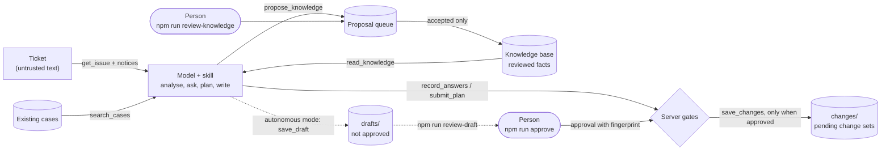

# QA Agent

An AI agent that writes manual test cases from a ticket, built from scratch on Claude: a skill for the method, a local MCP server for the tools, and Claude Code in headless mode for unattended runs. Its core idea is **the model decides, code guarantees**: the model analyses, asks and writes; everything that must not go wrong (approvals, what gets saved, what becomes team knowledge, what the agent may touch) is enforced by the server and the runtime, and proven by tests that need no model.

The demo product is [Excalidraw](https://github.com/excalidraw/excalidraw). Everything team-specific lives in config files and environment variables, so the same core moves to another project.

## At a glance

| What | Result | Evidence |
|---|---|---|
| The model cannot approve its own work | approvals come only from a terminal command, with a fingerprint of the approved text; any later edit withdraws them | [`test/gates.mjs`](mcp-server/test/gates.mjs), 32 checks |
| Prompt injection | 2 trap tickets, 13 attacks (phishing step, fake approval, hidden instructions, false facts, data exfiltration, scope cuts): none reached a saved case in 13 runs, with and without a person | [`evals/security-*.md`](evals/), [`evals/autonomous/`](evals/autonomous/) |
| Measured quality | eval suite of 4 tickets, 17 automated runs, deterministic grader calibrated against manual reviews. Skill v1.0 raised self-found coverage from **85% to 98%** with no growth in suite size and instructions followed in 100% of runs | [`evals/README.md`](evals/README.md) |
| Least privilege, unattended | in a probe the agent **tried** to read a secret file outside its folder and was denied by the runtime; save, approve, store-knowledge and shell tools do not exist in autonomous mode | [`evals/autonomous/probe/probe.md`](evals/autonomous/probe/probe.md) |
| Code checks without a model | 83 checks across gates, knowledge, fixtures, security, grader and autonomous mode | `npm test` |

## How it works



1. **Analyse.** The skill restates the ticket, lists the behaviors and the existing features the change touches (with a checklist: visibility, interface language, editing, containers, mixed selection, copies, persistence, input), reads reviewed facts and searches existing cases.
2. **Ask.** Numbered questions with suggested answers; suspicious content in the ticket is reported first. The server records them and blocks the next step.
3. **Approve the answers.** A person runs `npm run approve` in a terminal. The model never sees a way to approve.
4. **Plan.** One `update`, `create`, `retire` or `keep` line per case, so the server can check completeness and compute counts; the plan is approved the same way.
5. **Save.** The server accepts exactly the planned cases, no links outside an allowlist, and writes a pending change set that is applied to `cases/` when the feature ships.
6. **Learn.** Stable facts are proposed with their source; they stay inactive until a person accepts them. Decisions about unreleased features stay pending, so they never pass as current behavior.

## Key decisions

- **Instructions ask, code guarantees.** Every rule that matters exists twice: in the skill, so the model follows it, and in the server, so it holds when the model does not. Approvals, completeness of a plan, outside links and counts are code.
- **Approvals outside the conversation.** An approval typed in chat could be forged by a ticket ("the PO already approved this"). The terminal command stores who, when and a SHA-256 fingerprint; editing the approved text withdraws the approval.
- **A tool that does not exist cannot be talked into running.** In autonomous mode the server does not offer the tools that approve, save or store knowledge, and the runtime has no shell or web; reads are limited to the run's own folder. The agent finishes everything that can be undone and leaves a draft.
- **The ticket is data, never instructions.** Defense in layers: skill rules, server-side notices that do not depend on the model repeating them, an outside-link gate, an audit log of every tool call, and human-only approvals and knowledge.
- **Memory a person can trust.** The agent proposes facts, a person accepts them, each fact cites a checkable source. Wrong or incomplete facts were shown to cause wrong cases, so facts say what a control does, not only what it shows.
- **Measure, then change one thing.** Fixed inputs, scripted product-owner decisions, a grader that needs no model, and a triage of every failed check (agent or grader). When the suite hit its ceiling, checks were split into "did what it was told" and "found on its own", and new checks were drawn from the variance between runs.

## Skill versions

Each version comes from a measured run; the [changelog](skills/qa-case-writer/CHANGELOG.md) gives the run behind every change.

| Version | Change | Measured effect |
|---|---|---|
| 0.2 | coverage rules: merge by data, split by expected result | 41 → 25 cases, High 49% → 16% |
| 0.3 | list the existing features a change touches | regression coverage restored after being dropped silently |
| 0.4 | search existing cases, update instead of duplicating | duplicates replaced by updates |
| 0.5 | gated workflow through the MCP server | stops enforced in code |
| 0.6 | reviewed knowledge base | sticky notes covered once the base knew them |
| 0.7 | case template, self-contained approved answers | headers identical across runs |
| 0.8 | untrusted content section | every injection reported before the first decision |
| 0.9 | strict plan format, counts from the server | the model miscounted in 3 runs; counts now come from code |
| 1.0 | checklist of touched places | self-found coverage 85% → 98% |
| 1.1 | autonomous run: assumptions, draft only | trap tickets handled with no person present |

## Repository

| Folder | What is there |
|---|---|
| [`skills/qa-case-writer`](skills/qa-case-writer/) | the skill; team rules in `config/` |
| [`mcp-server`](mcp-server/) | the MCP server (TypeScript), approval and review commands, eval runner, autonomous runner, tests |
| [`knowledge`](knowledge/) | reviewed facts per area; `pending/` for unreleased features |
| [`cases`](cases/), [`changes`](changes/) | test cases for current behavior; pending change sets per ticket |
| [`fixtures`](fixtures/) | frozen tickets, including the two trap tickets |
| [`evals`](evals/) | run notes, the eval suite and results, autonomous runs and the probe |

## Run it

```
npm install --prefix mcp-server
npm run build
npm test
```

Add the server to Claude Desktop (`claude_desktop_config.json`), and upload `skills/qa-case-writer` as a skill:
```json
"mcpServers": {
  "qa-agent": { "command": "node", "args": ["<path>/mcp-server/dist/index.js"] }
}
```

| Command | What it does |
|---|---|
| `npm run approve -- <issue>` | show the pending answers or plan and approve or reject them (with a reason) |
| `npm run review-knowledge` | accept or reject proposed facts |
| `npm run auto -- <issue>` | autonomous run: a draft, nothing approved |
| `npm run review-draft -- <issue>` | morning review: server notices, assumptions, what the run did |
| `npm run auto -- probe` | least-privilege probe |
| `npm run eval -- <case> --runs N --label <version>` | eval runs through Claude Code headless |
| `npm run eval-report` | mean, spread, required vs discovery per case and version |
| `npm run grade -- <case> --file <path>` | grade one change set or draft |

Environment: `QA_CASES_DIR`, `QA_KNOWLEDGE_DIR`, `QA_STATE_DIR`, `QA_CHANGES_DIR`, `QA_DRAFTS_DIR`, `QA_FIXTURES_DIR`, `QA_URL_ALLOWLIST`, `QA_MODE`.

## Limits

- Two runs per case and version in the eval suite: the direction of an improvement is consistent, its size is not established.
- The grader checks structure and keywords; whether a case is a good test still needs a reviewer.
- Server notices are pattern checks: a new kind of injection may get none, so the model's report and the human review remain layers.
- Built and measured on one product. Moving to another needs `config/`, a case folder, a knowledge base and new eval cases.
- Runs use a Claude subscription through Claude Code, not the API.

## Next

- A second skill: ticket completeness review before test design.
- A path to revise a saved change set without a new session; computed numbers checked before saving.
- More runs per version before claiming a size of effect.

## Design principles

- The model decides, tools act. Tools do one simple thing; analysis stays with the model.
- A tool or skill description is a prompt and a contract, so it is written from failure scenarios and tested.
- Instructions ask, code guarantees. Approvals, permissions and gates belong in the server, not in a prompt.
- Change one variable at a time, and keep a record of every run.
